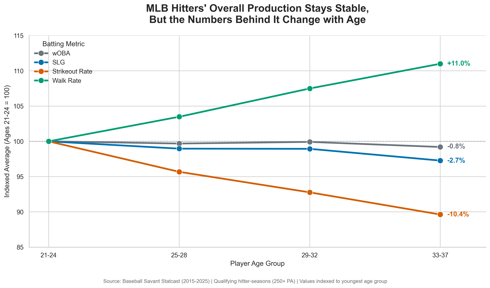

# MLB Hitter Aging: Changes in Plate Discipline and Power

**CS 625 – Data Visualization | Semester Project**  
**Name:** William Glavin 
**Date:** October 2026

## Dataset Description

This project uses MLB Statcast batting data from [Baseball Savant](https://baseballsavant.mlb.com/), covering the 2015–2025 seasons. The dataset contains season-level batting statistics for position players with at least 250 plate appearances in a season. Each row represents a *player-season*, meaning that the same player may appear in multiple years.

For the final visualization, I focused on hitters aged 21–37 and grouped them into four age ranges: 21–24, 25–28, 29–32, and 33–37. I compared four statistics:

- **wOBA (weighted on-base average):** A measure of overall offensive production that weights different ways of reaching base according to their run value.
- **SLG (slugging percentage):** Total bases per at-bat, reflecting extra-base-hit production as well as overall hitting.
- **K% (strikeout rate):** The percentage of plate appearances ending in a strikeout.
- **BB% (walk rate):** The percentage of plate appearances ending in a walk.

The data were processed and summarized using Python and pandas. I calculated the average of each metric across qualifying player-seasons within each age group.

**Original source:** [Baseball Savant – Statcast](https://baseballsavant.mlb.com/)  
**Dataset used:** [`stats.csv`](stats.csv)

## Research Question and Initial Hypothesis

**How does offensive performance differ across age groups of MLB hitters, and what do individual batting metrics reveal that an overall performance measure might hide?**

My original expectation was that hitters' overall offensive production, measured by wOBA, would peak and then decline as they got older. The exploratory analysis did not show the pronounced decline I expected. Average wOBA was nearly unchanged across ages 21–32 and only slightly lower for ages 33–37.

That led me to look beyond the overall measure. I found that the older age groups had lower strikeout rates and higher walk rates, while slugging percentage was somewhat lower. These differences became the focus of the final chart.

## Final Visualization

**Chart implementation:** [`edaFinal.py`](edaFinal.py)  
**Chart image:** [`final_statcast_chart.png`](final_statcast_chart.png)

## Findings and Interpretation

The chart compares four batting metrics across the same age groups. Since wOBA, SLG, K%, and BB% use different numerical scales, I indexed each metric to **100 for ages 21–24**. A value of 110 therefore represents a 10% increase relative to the youngest group, not an original batting rate of 110%. The labels at the right show the relative change from ages 21–24 to ages 33–37.

| Metric | Relative change, ages 21–24 to 33–37 |
|---|---:|
| Walk rate (BB%) | +11.0% |
| Strikeout rate (K%) | −10.4% |
| Slugging percentage (SLG) | −2.7% |
| Weighted on-base average (wOBA) | −0.8% |

The most noticeable changes are in walk rate and strikeout rate. Older qualifying hitters in this dataset walked more frequently and struck out less frequently, which is consistent with stronger plate-discipline outcomes. At the same time, slugging percentage declined modestly. Despite those differences, wOBA remained relatively stable.

This was more interesting than the simple decline I originally expected. **Overall offensive production tells only part of the story: different components of hitting show different patterns across age groups.**

There are important limitations. This is a comparison of qualifying *player-seasons*, not a study following the same hitters as they age. Players who remain in MLB and reach 250 plate appearances at older ages may differ from those who do not. The results therefore describe associations in this selected dataset; they do not establish that individual players necessarily improve their plate discipline or maintain their offensive production as they get older. The indexed values also emphasize *relative* differences, so they should not be confused with percentage-point changes in the original statistics.

## Design Decisions

I initially explored separate charts for wOBA, slugging percentage, isolated power, strikeout rate, and walk rate. For the final visualization, I selected **one line chart with four colored lines** so the audience could compare the trends together instead of moving between several figures.

A line chart is appropriate because the age groups have a meaningful order, and the connected points make the direction of each trend easy to follow. The chart uses distinct colors and a legend to identify each metric. A dashed horizontal line at 100 marks the common baseline, while endpoint labels show the relative changes directly. The headline highlights the contrast between stable overall production and changes in the underlying metrics.

Normalization was the most important design decision. Plotting the original values on one shared axis would make some trends difficult to see because the statistics have different scales. Indexing each series to the youngest age group makes their relative changes comparable. I kept the axis labeled and included an explanation of the baseline to make this transformation clear. The final chart was created in **Python using pandas, Seaborn, and Matplotlib**.

The report title, “MLB Hitter Aging: Changes in Plate Discipline and Power,” reflects the overall focus of the project. The chart's headline, “MLB Hitters' Overall Production Stays Stable, But the Numbers Behind It Change with Age,” emphasizes the unexpected finding that overall offensive production remains relatively stable, even as walk rates increase, strikeout rates decrease, and slugging percentage declines slightly.

## Final Thoughts

This project changed direction as I worked through the data. I began with the assumption that offensive performance would decline noticeably with age, but the initial wOBA results did not support that simple narrative. Exploring additional metrics helped me identify a more interesting finding: the components of offensive production differ across age groups even when the overall measure changes very little.

One challenge was deciding how to present statistics with different units and scales without making the chart confusing. Earlier sketches used separate charts, but the indexed four-line chart made it possible to show the main comparisons in one visualization. I also had to think carefully about what the data could support, particularly the difference between comparing age groups and tracking individual players over time.

I spent approximately **8 hours** on data preparation, exploratory analysis, sketching, implementation, and the final report. The biggest lesson was that visualization is not only about displaying results; it can also help refine the question and reveal a more useful story than the one originally expected.

## References

1. Major League Baseball. [Baseball Savant – Statcast](https://baseballsavant.mlb.com/). Source of the 2015–2025 batting data.
2. Major League Baseball. [MLB Glossary: Weighted On-Base Average (wOBA)](https://www.mlb.com/glossary/advanced-stats/weighted-on-base-average). Definition and context for wOBA.
3. Munzner, T. (2014). *Visualization Analysis and Design*. CRC Press. Course reference for visualization design principles.
